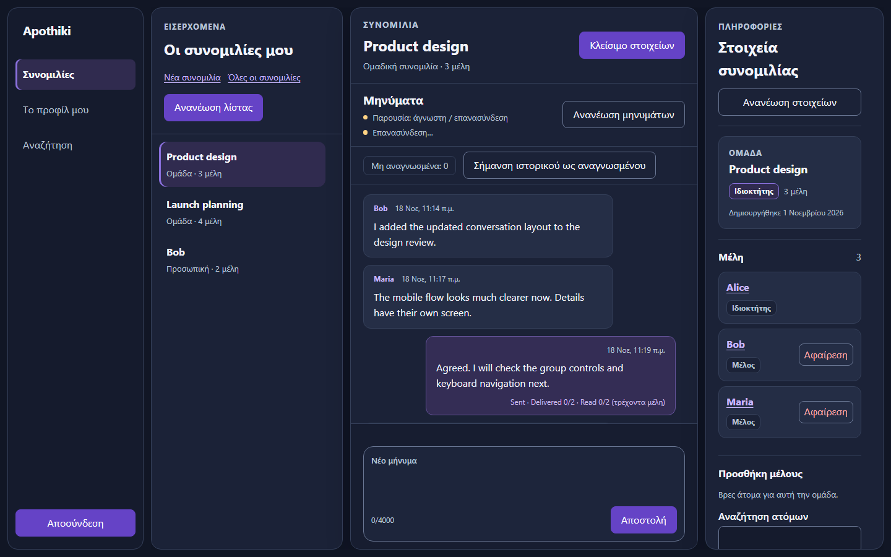
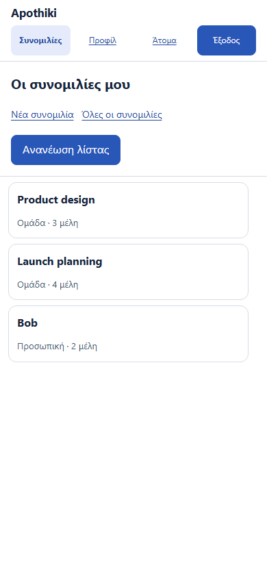
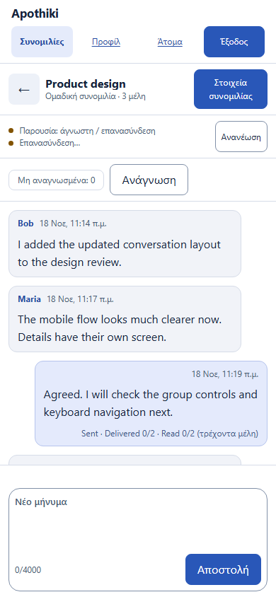
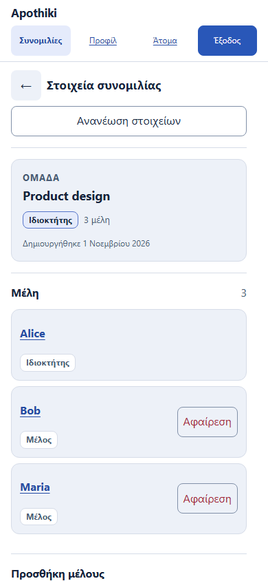
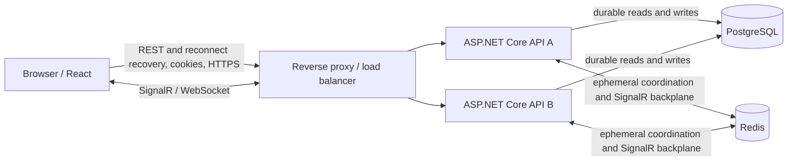

# Apothiki

Apothiki is a full-stack messaging application with durable conversations and receipts, a responsive React interface, and live updates across multiple API processes. PostgreSQL owns the data; SignalR and Redis carry the transient realtime experience.

**Stack:** ASP.NET Core · EF Core · SignalR · PostgreSQL · Redis · React · TypeScript · Vite · Playwright

## See the app

These screenshots use fictional demo accounts and messages from a [repeatable Playwright fixture](frontend/portfolio/capture.spec.ts). The fixture mocks REST data, so its reconnect indicator does not represent a live server connection. The interface is currently in Greek.



| Mobile conversations | Mobile chat | Mobile group details |
| --- | --- | --- |
|  |  |  |

## What it does

- Cookie-based registration, sign-in and sign-out; profiles and user search.
- Direct and group conversations, with authorized membership management.
- PostgreSQL-backed message history, idempotent sends using `ClientMessageId`, and unread/read progress.
- Live messages, authorized conversation presence, typing indicators, and delivery/read receipt updates over SignalR.
- Per-member group receipt snapshots and aggregates. **Sent** means a PostgreSQL commit; **Delivered** requires a durable recipient acknowledgement; **Read** means durable read progress. `Read ⇒ Delivered ⇒ Sent`.
- Reconnect and REST resynchronization after missed realtime events, including messages and receipts.
- Redis-backed coordination across API processes, including cross-instance membership revocation and protection against stale subscriptions after rejoin.
- Desktop conversation workspace and a one-screen-at-a-time mobile flow, with keyboard, focus and reduced-motion support.
- Optional, on-demand summaries of unread **group** messages through a locally configured Ollama model. Viewing a summary never marks messages as read.

## Architecture and consistency



The application grew from identity and profiles to conversations, durable messages, realtime subscriptions, presence/typing/receipts, and finally multi-instance coordination. Message writes commit in PostgreSQL before live publication. A successful SignalR send is neither a durable write nor proof that a browser received an event. Clients recover missed updates through REST; there is no durable SignalR replay or exactly-once delivery.

Redis supports temporary connection ownership, typing leases, revocation coordination, and the SignalR backplane. It is **not** the message store or an authorization boundary. Membership is checked against PostgreSQL; removal uses a cross-instance revocation barrier and fails closed when that barrier cannot be established. The [Stage 6 production handoff](docs/stage6-production-handoff.md) explains the failure model and operational requirements.

## Run locally

Prerequisites: the SDK selected by [global.json](global.json), Node.js/npm compatible with the [frontend CI setup](.github/workflows/ci.yml), Docker with Compose, and the .NET local tool manifest. The commands below are PowerShell examples from the repository root. The password is a local example; choose your own value and keep it out of tracked files.

```powershell
$env:POSTGRES_PASSWORD = '<local-password>'
docker compose up -d postgres
dotnet tool restore
$env:ASPNETCORE_ENVIRONMENT = 'Development'
$env:ConnectionStrings__ChatDatabase = 'Host=localhost;Port=5432;Database=realtime_chat;Username=chat_app;Password=<local-password>'
dotnet ef database update --project src/Chat.Api
dotnet run --project src/Chat.Api --no-launch-profile --urls http://localhost:5080
```

In a second terminal:

```powershell
npm --prefix frontend ci
npm --prefix frontend run dev -- --host localhost --port 5173
```

Open `http://localhost:5173`; the frontend defaults to `http://localhost:5080` for the API. Set `VITE_API_BASE_URL` in `frontend/.env.local` if the API origin differs. The single-instance development setup leaves Redis disabled. For a Redis-backed multi-instance topology, start `docker compose up -d postgres redis` and follow the [Redis configuration](docs/redis-infrastructure.md) and [Stage 6 handoff](docs/stage6-production-handoff.md); the Compose Redis service is for local development, not a production deployment.

AI summaries are disabled by default. Normal chat does not require Ollama or a downloaded model. To enable them locally, install and start Ollama separately, pull a model yourself (for example `ollama pull qwen3:4b`), and set `UnreadSummaries__Enabled=true` and `UnreadSummaries__Model=qwen3:4b` in the **backend** terminal before running the API. The default `UnreadSummaries__BaseUrl` is `http://localhost:11434`. See [AI unread summaries](docs/ai-unread-summaries.md) for limits and privacy behavior.

## Verification

GitHub Actions [CI](.github/workflows/ci.yml) builds the backend in Release, runs backend tests, lints/builds the frontend, runs Playwright UI tests, and runs real browser/API/PostgreSQL E2E tests. Stage 6 E2E also uses Redis and **two separate API processes** to exercise cross-instance messaging, receipts, revocation, and restart recovery. CI verifies changes; it does not deploy the app.

Useful local checks:

```powershell
dotnet build RealtimeChat.sln --configuration Release
dotnet test RealtimeChat.sln --configuration Release --no-build
npm --prefix frontend run lint
npm --prefix frontend run build
npm --prefix frontend run test:ui
```

Browser tests need Playwright Chromium (`npx playwright install chromium` from `frontend`). Real E2E requires a **dedicated disposable** PostgreSQL database through `E2E_CONNECTION_STRING`; the multi-instance suite also needs `E2E_REDIS_CONNECTION_STRING`. See the [Stage 6 test and failure notes](docs/stage6-production-handoff.md) before running them. Portfolio images can be regenerated from `frontend` with `npx playwright test --config playwright.portfolio.config.ts`; this fixture is outside the normal UI test suite.

## Deployment status and limits

Apothiki is locally runnable and has automated multi-instance verification; it has **not** been publicly deployed as a production service. A deployment needs shared PostgreSQL and Redis, applied EF migrations, persistent shared Data Protection keys, a unique server instance ID per API process, HTTPS/WSS, configured CORS/origin rules, and load-balancer affinity where SignalR negotiation requires it. Compatible instances must share a controlled Redis namespace. Health endpoints and degraded behavior are documented in the [production handoff](docs/stage6-production-handoff.md).

Redis or network interruption can lose live events while committed messages and receipt progress remain in PostgreSQL. REST recovery is required. There is no outbox, durable realtime replay, production load benchmark, or Redis HA topology in this repository. Dependency audit warnings, including frontend npm advisories and a transitive `Microsoft.OpenApi 2.0.0` advisory, remain known items rather than a claim of a clean security audit.

## Explore the repository

| Path | Purpose |
| --- | --- |
| [`src/`](src/) | ASP.NET Core API, domain logic, EF Core persistence and SignalR |
| [`frontend/`](frontend/) | React application and Playwright suites |
| [`tests/`](tests/) | Backend tests, including PostgreSQL/Redis integration coverage |
| [`docs/`](docs/) | Design decisions, verification and operational notes |

Start with the [Apothiki design system](docs/apothiki-design-system.md), [Stage 5 semantics](docs/stage5-semantics.md), [reconnect/REST recovery](docs/signalr-reconnect.md), [AI unread summaries](docs/ai-unread-summaries.md), and [Stage 6 production handoff](docs/stage6-production-handoff.md).

## Roadmap

Public deployment is future work. Android and push-notification work is tracked separately in the [#124–#130 roadmap](https://github.com/ChristosGiann/Realtime-Chat-Platform/issues/124).
